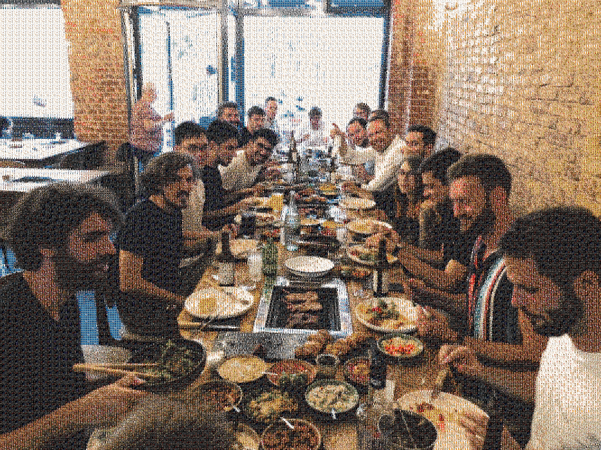

# Photomosaic Generator Studio

> **[English version available here](README.md)** | **[Explorer la Demo GitHub Pages](https://habodall.github.io/Photomosaic-generator/)**

Generateur de photomosaiques haute performance et convivial en Python pour images et videos, propulse par la correspondance de couleurs CIELAB, l'indexation spatiale cKDTree, des algorithmes d'anti-repetition, un telechargeur d'images par theme et des connecteurs cloud personnels.

---

## Exemple de Resultat

<p align="center">
  
  
  <br>
  <i>A gauche : Image cible d'origine | A droite : Photomosaique generee (CIELAB 2x2 sous-quadrants, tuiles de 20px)</i>
</p>

---

## AVERTISSEMENT VIBE CODING ET SECURITE

> **A LIRE ATTENTIVEMENT AVANT UTILISATION**
>
> Ce depot a ete meure et enrichi dans le cadre d'une **experience de "vibe coding"** (developpement rapide assiste par IA). Bien que le code soit meure et teste, les utilisateurs **DOIVENT** faire preuve d'une grande prudence concernant la securite, les requetes reseau et la gestion des identifiants d'API.

### Bonnes Pratiques de Securite :
1. **Cles API et Secrets :** Ne jamais inscrire en dur de cles d'API, jetons d'acces OAuth ou mots de passe WebDAV directement dans les scripts ni les publier sur un depot Git public.
2. **Variables d'Environnement :** Utilisez toujours un fichier `.env` (ignore par le fichier `.gitignore`) ou des variables d'environnement système pour stocker vos secrets.
3. **Securite HTTP et SSL :** Assurez-vous que tous vos points d'acces distants (Immich, Nextcloud/WebDAV, API externes) utilisent le protocole securise HTTPS en production.
4. **Services Tiers :** Verifiez les limites de requetes (*rate limits*) et les conditions d'utilisation lors du telechargement massif d'images.

---

## Fonctionnalites

- **Correspondance de Couleurs Avancee :**
  - **Espace de Couleur CIELAB (L\*a\*b\*) :** Calcul de distance chromatique base sur la perception visuelle humaine.
  - **Analyse par Sous-Quadrants :** Decoupage 2x2 (ou personnalise) capturant les degrades et textures internes de chaque tuile.
  - **Recherche Rapide cKDTree :** Recherche ultra-rapide des meilleures tuiles via `scipy.spatial.cKDTree`.
  - **Penalite d'Anti-Repetition :** Empeche la reutilisation repetitve de la meme tuile a proximite.
  - **Superposition Reglables (Overlay) :** Melange doux entre l'image cible originale et les tuiles de la mosaique.

- **Telechargeur d'Images par Theme (`photomosaic.downloaders`) :**
  - **Wikimedia Commons** (Domaine public et licences libres)
  - **Archive.org** (Archives d'images du domaine public)
  - **Openverse** (Recherche de medias Creative Commons)
  - **API Unsplash, Pexels, Pixabay**

- **Connecteurs de Medias Cloud (`photomosaic.connectors`) :**
  - **Immich** (Gestionnaire de photos auto-heberge)
  - **API REST Google Photos**
  - **WebDAV / Nextcloud**

- **Interface Web Studio et CLI Conviviale :**
  - **Interface Web Interactive Streamlit (`app.py`) :** Glisser-deposer, curseurs en direct, previsualisation et telechargement par theme.
  - **Interface en Ligne de Commande (`photomosaic` CLI) :** CLI scriptable pour l'automatisation.
  - **Compatibilite des Anciens Scripts :** Prise en charge complete de `image2image.py` et `video2video.py`.

---

## Exploration sur GitHub Pages

Vous pouvez explorer la presentation interactive du projet directement sur GitHub Pages :
**[https://habodall.github.io/Photomosaic-generator/](https://habodall.github.io/Photomosaic-generator/)**

*Pour activer GitHub Pages sur votre depot :*
1. Allez dans les **Settings** (Parametres) du depot > **Pages**.
2. Dans **Build and deployment**, choisissez **Branch** : `main` (ou branche par defaut) et le dossier `/docs`.
3. Enregistrez pour publier le site de presentation !

---

## Installation

### Prerequis
- **Python 3.9+ / 3.12+**
- Git

### Etapes
```bash
# 1. Cloner le depot
git clone https://github.com/HaBODALL/Photomosaic-generator.git
cd Photomosaic-generator

# 2. Installer le package en mode editable
pip install -e .

# Optionnel : Copier la configuration d'environnement
cp .env.example .env
```

---

## Utilisation

### 1. Interface Web Interactive (Streamlit)
Lancez l'interface Web conviviale dans votre navigateur :
```bash
streamlit run app.py
```

### 2. Interface en Ligne de Commande (CLI)
```bash
# Generer une image mosaique
photomosaic image -i data/input.jpg -o data/output.jpg -p image_pool -s 30 --color_space lab --anti_repetition 2

# Generer une video mosaique
photomosaic video -i data/input.mp4 -o data/output.mp4 -p image_pool -s 20

# Telecharger des images par theme depuis Wikimedia Commons
photomosaic download -t "nature" -o image_pool --source wikimedia --limit 50
```

### 3. Utilisation des Anciens Scripts
```bash
# Image a Image
python image2image.py --input data/input.jpg --output data/output.jpg --pool image_pool --stride 30

# Video a Video
python video2video.py --input data/input.mp4 --output data/output.mp4 --pool image_pool --stride 20
```

---

## Tests Automatises

Pour executer la suite de tests unitaires :
```bash
pytest
```

---

## Licence

Distribue sous la licence MIT. Voir le fichier `LICENSE` pour plus de details.
